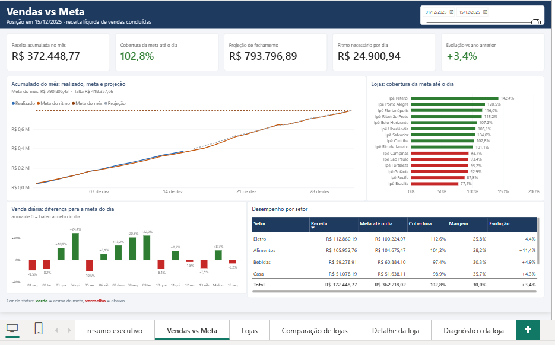
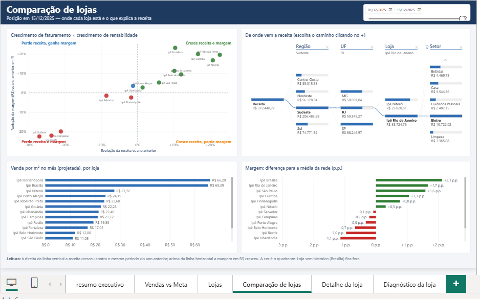
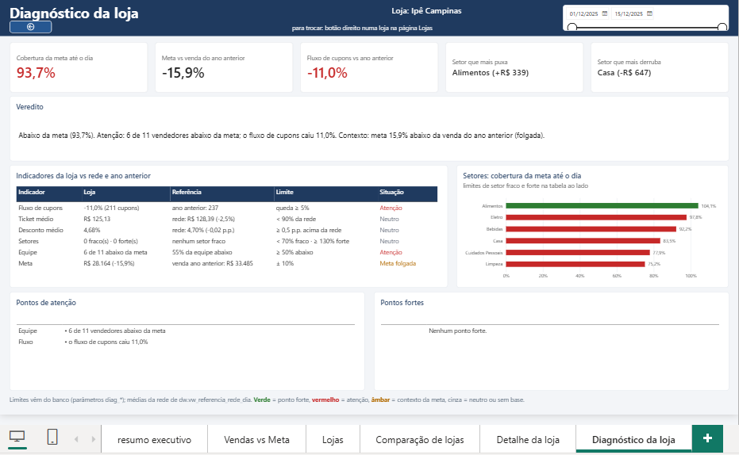
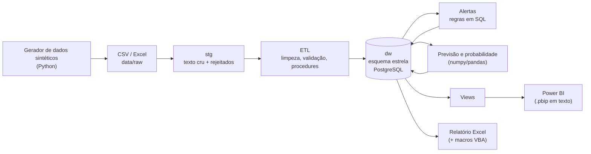

# Lojas Ipê — Análise Comercial e Financeira

Projeto de portfólio de Análise de Dados / BI: uma rede varejista **fictícia** de 15 lojas no Brasil, com **dados 100% sintéticos**, do arquivo bruto ao dashboard — gerador de dados, ETL com validações, data warehouse em PostgreSQL, previsão de vendas, alertas de anomalia, relatório Excel e Power BI.

## Perguntas de negócio que ele responde

- **As vendas estão batendo a meta?** Por loja, setor e dia, com cobertura da meta até o dia.
- **Quais lojas puxam e quais derrubam o resultado, e por quê?** Crescimento de receita contra o ano anterior, margem, fluxo de cupons, equipe e setores.
- **Como o mês deve fechar?** Realizado até hoje mais a previsão dos dias restantes, com faixa baixa e alta.
- **Qual a chance de bater a meta do mês?** Uma probabilidade por loja e para a rede, sempre apresentada como *estimativa*.
- **Quais lançamentos são suspeitos?** Regras de anomalia em SQL que geram alertas rastreáveis.

## O que o dashboard mostra


*Vendas vs Meta: acumulado do mês contra a meta e a projeção, cobertura por loja e desempenho por setor.*


*Comparação de lojas: quem cresce em receita e em margem, e de onde vem a receita (região, UF, loja, setor).*


*Diagnóstico da loja: veredito, indicadores contra a rede e o ano anterior, setores e equipe.*

## Arquitetura



**Stack:** PostgreSQL 18 · Python 3.12+ (pandas, numpy, SQLAlchemy, psycopg 3, openpyxl) · SQL e PL/pgSQL · Power BI (Power Query/M e DAX) · Excel/VBA · pytest e ruff · GitHub Actions.

Detalhes do contrato de entrada em [`docs/contrato_de_entrada.md`](docs/contrato_de_entrada.md); o restante da documentação técnica (ETL, alertas, previsão, simulador, relatório Excel) está em [`docs/referencia_tecnica.md`](docs/referencia_tecnica.md).

## Decisões técnicas

1. **Previsão sem vazamento do futuro.** *Problema:* um modelo de previsão pode "colar" no gerador de dados e acertar por trapaça. *Solução:* o módulo de previsão só enxerga o painel até a data de corte e, por teste, é proibido de importar o gerador ou o calendário comercial dele ([`tests/previsao/test_black_friday.py`](tests/previsao/test_black_friday.py): `test_o_modulo_de_previsao_nao_usa_parametros_do_gerador`). O efeito da Black Friday, por exemplo, é aprendido do histórico e só a data vem do calendário ([`docs/metodologia_previsao_eventos.md`](docs/metodologia_previsao_eventos.md)).
2. **Backtest para escolher o modelo.** *Problema:* "parece bom" não é critério. *Solução:* quatro abordagens (ingênua, decomposição, dois Holt-Winters) comparadas com treino até 30/06/2025 e teste de julho a dezembro. A decomposição venceu: no total da rede, o erro da previsão mensal ficou em cerca de 3% (a abordagem ingênua errou quase o dobro). Esse erro é levemente otimista, porque o modelo foi escolhido no próprio backtest (números em [`docs/metodologia_previsao_eventos.md`](docs/metodologia_previsao_eventos.md) e em [`docs/referencia_tecnica.md`](docs/referencia_tecnica.md)).
3. **Probabilidade calibrada e validada.** *Problema:* uma probabilidade só vale se for calibrada. *Solução:* o erro do resto do mês é estimado nos últimos 6 meses fechados, usando só o que se sabia na época. A probabilidade de bater a meta foi validada contra 9 meses de histórico e acerta bem mais que um chute de 50% (o erro cai de 0,25 para cerca de 0,11 nas lojas). Sem histórico ou sem meta, o resultado é "sem base", nunca 50% (detalhes em [`docs/metodologia_probabilidade.md`](docs/metodologia_probabilidade.md)).
4. **Previsão vigente por corte e teste de consistência.** *Problema:* versões diferentes do modelo convivem no banco, e quem lê podia misturá-las. *Solução:* a view `dw.vw_previsao_vigente` escolhe, para cada corte, a versão gerada por último, sem apagar o histórico. O comando `python -m src.previsao verificar` (somente leitura) refaz a previsão em memória e compara com o que está gravado, com tolerância de R$ 0,01 por loja; ele falha se a versão gravada não for a atual.
5. **Gravação atômica.** *Problema:* a probabilidade grava em três tabelas, e uma falha no meio deixava o banco com metade do resultado. *Solução:* as três gravações rodam numa só transação, com um commit no final e rollback em qualquer erro. Há teste de falha forçada na terceira gravação, que confirma que o banco fica idêntico ao de antes.
6. **Testes e CI com fluxo por pull request.** *Problema:* mudança direta no `main` sem revisão. *Solução:* 812 testes (incluindo os que usam um PostgreSQL descartável) rodam no GitHub Actions em Python 3.12 e 3.14, com ruff. Cada mudança entra por branch e pull request, com merge `squash`, e o `main` exige os checks `testes (3.12)` e `testes (3.14)` verdes.

## Limitações

- **Dados sintéticos.** Nomes, valores e comportamentos vêm de um gerador; as conclusões de negócio não valem para nenhuma empresa real.
- **A previsão subestima o fim de dezembro (Natal).** Na validação de várias origens, o total de 25 a 31/12 sai com viés de −14,4% e o de dezembro, −7,0%. Uma tentativa de modelar o Natal dia a dia piorou o resultado e foi revertida ([`docs/metodologia_previsao_eventos.md`](docs/metodologia_previsao_eventos.md)): há só um ano de histórico de Natal.
- **A probabilidade tende a ser conservadora.** Nas lojas, o previsto médio é 44,3% contra 47,9% observado; na rede, 44,8% contra 55,7%, mas sobre apenas 9 meses, então não permite conclusão fina.
- **A área em m² das lojas ainda não é realista:** é um cadastro fixo e fictício, e a venda por m² que sai dele não deve ser lida como diagnóstico.
- **Ainda em andamento:** o Power BI está em construção (ver os próximos passos), e a probabilidade de bater a meta já está no banco, mas **ainda não tem visual** no dashboard.

## Como rodar

Requisitos: Python 3.12 ou mais novo, PostgreSQL 18 e, para o dashboard, Power BI Desktop (Windows). O banco do projeto usa um usuário próprio; o [`.env.example`](.env.example) só traz os **nomes** das variáveis, e o `.env` real nunca vai para o git.

```
python -m venv .venv
.venv\Scripts\activate
pip install -r requirements.txt
copy .env.example .env             # preencha com os dados do seu PostgreSQL
python -m src.gerador              # gera os CSVs em data/raw/
python -m src.banco                # cria as tabelas no banco do .env
python -m src.banco --procedures   # procedures de carga e funções
python -m src.etl carregar         # lê, limpa, valida e carrega o dw
python -m src.banco --views        # views para o Power BI
python -m src.previsao gerar --gravar   # previsão de 3 meses
python -m src.relatorios fechamento     # relatório Excel em data/processed/
pytest                             # testes sem banco (pytest -m banco inclui os de banco)
```

O dashboard fica em [`powerbi/lojas_ipe.pbip`](powerbi/lojas_ipe.pbip) (versionado em texto); a senha do PostgreSQL é pedida pelo Power BI e fica só no Windows. Convenções do dashboard em [`docs/powerbi_padroes.md`](docs/powerbi_padroes.md); macros do relatório Excel em [`docs/macro_vba.md`](docs/macro_vba.md).

## Próximos passos

Visuais da probabilidade de bater a meta no Power BI, segurança por loja (RLS) e pipeline de dados na nuvem. Os dois últimos estão **planejados e ainda não implementados**; o roadmap completo está em [`docs/referencia_tecnica.md`](docs/referencia_tecnica.md#roadmap).

## Uso de IA

Desenvolvi este projeto com o Claude Code como ferramenta de programação. As decisões de modelagem e de negócio, a revisão de cada mudança e a aprovação de cada commit são escolhas minhas. O projeto tem 812 testes automatizados que rodam no CI a cada pull request.

## Autor

**Gustavo Carvalho Duarte** · [LinkedIn](https://www.linkedin.com/in/gustavo-cduarte/) · [GitHub](https://github.com/gustavocduarte)
